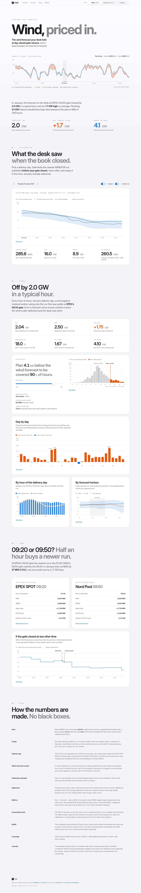

# Gale

**Wind, priced in.** Gale is a decision tool for a GB energy desk buying power in the day-ahead auctions. For every delivery day it shows the wind forecast that was actually on the desk at gate closure, inside an uncertainty band measured from January's real errors. It then works out how far that forecast can be trusted, and turns the answer into a planning rule: how many MW below the forecast to plan so that wind covers the position a chosen share of the time. Everything comes from Elexon BMRS data (`WINDFOR` forecasts, `FUELHH` wind outturn) for purchase decisions made in January 2026.



**Live app:** [https://swsqc.vercel.app/?date=2026-01-15&gate=09%3A20](https://swsqc.vercel.app/?date=2026-01-15&gate=09%3A20) · **API docs:** [https://swsqc.vercel.app/api/docs](https://swsqc.vercel.app/api/docs)

| | |
|---|---|
| Dark mode | [docs/screenshots/desktop-dark.png](docs/screenshots/desktop-dark.png) |
| Mobile (390 px) | [light](docs/screenshots/mobile-light.png) · [dark](docs/screenshots/mobile-dark.png) |

## What January 2026 says

The forecast is the one on the desk at the **EPEX SPOT 09:20** gate. The scope is 31 delivery days, 744 hours, and errors are forecast minus actual.

| Measure | Value |
|---|---|
| Mean absolute error | **2,035 MW** (18.0% of mean outturn, 11.3 GW) |
| Mean bias | **+1,749 MW**: the forecast ran high on 27 of 31 days |
| Buffer for 90% cover | **4,095 MW** below the forecast. It was breached in 75 of 744 hours. When each day's buffer is set without that day, 11.4% of hours breach. |
| EPEX 09:20 vs N2EX 09:50 | N2EX sees the 09:30 run instead of the 07:30 one. MAE improves by **27 MW (1.3%)**. |
| Worst day | **28 Jan**: 270.8 GWh forecast against 142.5 GWh delivered |

To reproduce these figures from raw Elexon data, run `python3 scripts/crosscheck.py` (see [Testing](#testing)).

## Quick start

### Docker (one command)

```bash
docker compose up --build
open http://localhost:8000          # app;  API docs at http://localhost:8000/api/docs
```

One container serves the API and the built frontend. The first request fetches January from Elexon, which takes about 2 s. After that everything is served from memory.

### Local development

You need Python 3.12 or newer with [uv](https://docs.astral.sh/uv/), and Node 20.19 or newer.

```bash
# API on :8000 with auto-reload
cd backend && uv sync && uv run uvicorn gale.main:app --reload --port 8000

# Web on :5173; Vite proxies /api to :8000 (override with GALE_API_URL)
cd frontend && npm ci && npm run dev
```

If `make` is installed, `make help` lists shortcuts: `make dev`, `make test`, `make lint`, `make docker`, `make check-docker`.

## Project structure

```
gale/
├── backend/                     Python API (FastAPI, httpx, pydantic; managed by uv)
│   ├── pyproject.toml           Dependencies and ruff/mypy/pytest config
│   ├── uv.lock                  Locked dependency graph
│   ├── src/gale/
│   │   ├── main.py              App factory: routes, error handlers, gzip, access log, optional static mount
│   │   ├── config.py            Settings from GALE_* environment variables
│   │   ├── repository.py        Loads and caches the January dataset once per process (single-flight)
│   │   ├── concurrency.py       TaskGroup helper that re-raises the first real error
│   │   ├── observability.py     One-line JSON logging
│   │   ├── elexon/
│   │   │   ├── client.py        Chunked, concurrent, retrying Elexon client with response validation
│   │   │   └── schemas.py       Wire models for WINDFOR / FUELHH stream rows
│   │   ├── domain/              Pure logic, no I/O
│   │   │   ├── periods.py       Delivery day (23:00–23:00 UK), decision instants, Europe/London handling
│   │   │   ├── scope.py         "January decisions" turned into concrete fetch windows
│   │   │   ├── selection.py     Latest forecast at decision time; hindcast exclusion
│   │   │   ├── cleaning.py      Deterministic de-duplication rules
│   │   │   ├── alignment.py     Half-hourly outturn to hourly means
│   │   │   ├── metrics.py       MAE/RMSE/bias/nMAE, type-7 quantile, histogram
│   │   │   ├── analysis.py      Decision day, accuracy report, buffer table, horizon, timing sweep
│   │   │   ├── markets.py       EPEX SPOT / N2EX gate-closure presets
│   │   │   └── models.py        Value types (rows, points, error samples)
│   │   └── api/
│   │       ├── routes.py        /api/health and /api/v1/* handlers
│   │       ├── schemas.py       Typed response models (the public contract)
│   │       ├── presenters.py    Domain to response mapping and rounding
│   │       └── errors.py        Uniform JSON errors: 422, 502, 404, 500
│   └── tests/                   85 pytest tests (domain, client via MockTransport, repository, API)
├── frontend/                    React 19 + TypeScript + Vite; d3-scale and d3-shape only for charts
│   ├── src/App.tsx              Page composition, shared state (delivery day, gate), shareable URL
│   ├── src/sections/            Nav, Hero (+ January ribbon), 01 Forecast, 02 Accuracy (+ BufferPanel), 03 Timing, 04 Method, Footer
│   ├── src/components/          Segmented control, gate picker, date stepper, switch, stat, status views
│   ├── src/components/charts/   Hand-built SVG charts with crosshair, tooltip, keyboard reading and data tables; the hero's GlanceRibbon
│   ├── src/lib/                 Formatting (UK time), series helpers, label placement, tweening, URL state, with Vitest tests
│   ├── src/hooks/               Data fetching, element width, reveal-on-scroll, reduced motion, tweening
│   └── src/styles/              Design tokens (light/dark) and base styles
├── api/index.py                 Vercel serverless entrypoint exposing the FastAPI app
├── vercel.json                  Vercel build, function and rewrite configuration
├── requirements.txt             Runtime deps exported from uv.lock (read by Vercel)
├── Dockerfile                   Multi-stage: Node build, then uv resolve, then slim non-root runtime
├── docker-compose.yml           One-command local run on :8000
├── Makefile                     Optional developer shortcuts
├── scripts/crosscheck.py        Recomputes headline numbers from raw Elexon data and diffs them with the API
├── .github/workflows/ci.yml     Lint, type-check, test and build for both halves, plus a Docker build
└── docs/
    ├── ARCHITECTURE.md          Architecture, data flow, decisions and trade-offs (tech-lead walkthrough)
    ├── PITCH.md                 Five-minute client pitch with the computed numbers
    └── screenshots/             UI screenshots used here
```

## API

All routes are versioned under `/api/v1` and documented with OpenAPI at **`/api/docs`**. Data responses send `Cache-Control: public, max-age=300, s-maxage=86400, stale-while-revalidate=86400`, because January 2026 never changes and the CDN can absorb cold starts.

| Route | Purpose |
|---|---|
| `GET /api/health` | Liveness check. Makes no upstream calls and sends `no-store`. |
| `GET /api/v1/meta` | Scope, delivery-day definition, gate presets and data coverage (runs, hindcasts excluded, missing periods) |
| `GET /api/v1/decision?delivery_date=2026-01-15&decision_time=09:20` | The forecast on the desk for one delivery day: provenance, hourly points with band and actuals, earlier runs, KPIs |
| `GET /api/v1/series?decision_time=09:20` | Every delivery hour of the month in one compact response: per day, the forecast on the desk at the gate and the outturn as two arrays. Drives the hero's January ribbon. |
| `GET /api/v1/accuracy?decision_time=09:20` | Month metrics, by day, by hour, error histogram, buffer table for 50–99% confidence (in and out of sample) |
| `GET /api/v1/horizon` | Error against lead time across every January run |
| `GET /api/v1/timing` | Accuracy for every 10-minute decision time on D-1 (00:00–22:50) |

`decision_time` is UK local time on the day before delivery, written `HH:MM`. It must be before 23:00, when the delivery day opens. Bad parameters return **422**, an Elexon outage returns **502**, and both use the same JSON envelope. Stack traces are never returned.

## Method and assumptions

- **Delivery day** is 23:00 UK on D-1 to 23:00 UK on D. This is the contract day of both auctions, not the 00:00–24:00 settlement day. The sources are listed below. Every conversion uses `zoneinfo` `Europe/London`, with no fixed offsets.
- **Decision time** is a parameter, with presets for EPEX SPOT GB 60-min at **09:20** and Nord Pool N2EX GB at **09:50**, plus any custom time on D-1.
- **Forecast selection.** For each delivery hour, Gale uses the latest WINDFOR run with `publishTime ≤ decision time` and `publishTime ≤ hour start`. The run schedule is never hard-coded, so the irregular 12:25 run on 15 Jan is picked up as it happened.
- **Hindcasts excluded.** Every run also restates hours that had already begun when it was published: 15 per run on average, 3,841 rows in total. These rows are dropped before any selection or scoring.
- **Alignment.** Each hour's actual is the mean of its two FUELHH settlement periods. That is the energy delivered in the hour, which is exactly what an hourly day-ahead product buys. If either half-hour is missing, the hour is a gap, never a zero. Elexon does not document whether WINDFOR values are hourly averages or instantaneous values. The alternatives were checked: matching on identical `startTime`, or on a window centred on the hour, moves headline MAE by under 2% (−0.8% and −1.7% at 09:20).
- **De-duplication.** Forecasts are de-duplicated on `(publishTime, startTime)`, and the last row fetched wins. Actuals are de-duplicated on `startTime`, and the latest `publishTime` (a revision) wins. January had no duplicates in either dataset. The fetch chunks share boundary instants, so the rules are still needed.
- **Metrics.**
  - Error = forecast − actual, so a positive error means wind under-delivered and the desk was short.
  - MAE, RMSE, bias, P50 and P90 of |error| are reported.
  - Normalised MAE is MAE divided by mean outturn.
  - MAPE is deliberately not used: it explodes near zero wind and penalises over- and under-forecasts asymmetrically.
- **Uncertainty band.** The band is the forecast minus the P90 and P10 errors of every January run at a similar lead time (±3 h). The daily-energy range uses the P10–P90 of January's whole-day energy errors. Both are calibrated on January itself (in-sample), so they describe the month and do not predict it.
- **Buffer.** The buffer is the confidence quantile of hourly errors at the chosen gate (Hyndman–Fan type 7, the same as Excel `PERCENTILE.INC`). Its in-sample breach rate is 1 − confidence by construction. The leave-one-day-out figure is the honest estimate of how the rule would have performed.
- **Caveat.** The bias stays at +1.5 GW even one hour ahead. That is consistent with metered outturn being measured after constraint curtailment while the forecast describes available wind. These two datasets alone cannot prove the cause.

## Testing

```bash
cd backend && uv run ruff check && uv run ruff format --check && uv run mypy src tests && uv run pytest
cd frontend && npm run lint && npx tsc --noEmit && npm test && npm run build
python3 scripts/crosscheck.py            # live: raw Elexon vs a running API (default http://localhost:8000)
```

- **Backend (85 tests, no network).**
  - Hindcast exclusion and the irregular publish time.
  - A decision exactly at a publish time, and one second before it.
  - Missing half-hours and missing forecasts (gaps, not zeros).
  - De-duplication, including revisions.
  - Clock changes (23- and 25-hour delivery days).
  - Metrics against hand-computed values on a small synthetic market.
  - Buffer table, in and out of sample.
  - Elexon client tests using `httpx.MockTransport`: chunking, retries and backoff, `Retry-After`, malformed payloads, and a silently ignored filter.
  - Repository single-flight under 10 concurrent cold requests.
  - API contract tests with the repository swapped for a fake: 200, 422, 404, 502 and 500 envelopes, plus cache headers. The month series must agree hour for hour with the decision view.
- **Frontend (Vitest).** UK-time formatting across GMT and BST, number formatting, series helpers (including the ribbon's per-day bucketing), label placement (clamp, nudge, stack, drop), bar geometry, tweening, URL state.
- **NixOS note.** Ruff's PyPI wheel is a generic-Linux binary, and NixOS cannot run it without `nix-ld`. On such hosts, run `make check-docker`. It runs ruff, mypy and pytest inside `python:3.12`, as CI does.

## Deploying to Vercel

The repository deploys as one Vercel project. Vite builds the static frontend, which Vercel's CDN serves. FastAPI runs as a Python serverless function (`api/index.py`, default runtime Python 3.12), and `/api/*` is rewritten to it.

1. `npm i -g vercel`, then `vercel login`.
2. From the repository root, run `vercel` for a preview, then `vercel --prod`. No environment variables are required.
3. Check `https://<deployment>/api/health` and `https://<deployment>/api/docs`.

`vercel.json` sets `framework: null` and builds with `npm --prefix frontend`, publishing `frontend/dist`. Vercel installs Python dependencies from the root `requirements.txt`; regenerate it with `make requirements` after changing `uv.lock`. Files the function does not need are excluded with `excludeFiles`. `maxDuration` is 60 s, though a cold start takes about 2–3 s. The API's `s-maxage` lets the edge cache answer repeat requests without waking the function.

**Alternative hosts.** The Docker image honours `$PORT`, so it runs unchanged on Render, Railway, Fly.io, Cloud Run or Heroku (container stack).

## Configuration

| Variable | Default | Meaning |
|---|---|---|
| `GALE_ELEXON_BASE_URL` | `https://data.elexon.co.uk/bmrs/api/v1` | Elexon Insights API base |
| `GALE_HTTP_TIMEOUT_S` / `GALE_HTTP_RETRIES` / `GALE_HTTP_BACKOFF_S` | `20` / `3` / `0.5` | Per-request timeout, retries, base backoff (exponential, honours `Retry-After`) |
| `GALE_FETCH_CHUNK_DAYS` | `7` | Days per concurrent Elexon request |
| `GALE_FIRST_DECISION_DATE` / `GALE_LAST_DECISION_DATE` | `2026-01-01` / `2026-01-31` | Decision window (delivery = decision + 1 day) |
| `GALE_CACHE_MAX_AGE_S` / `GALE_CACHE_S_MAXAGE_S` | `300` / `86400` | Browser and CDN cache lifetimes |
| `GALE_STATIC_DIR` | unset (set in Docker) | Serve the built frontend from the API process |
| `GALE_LOG_LEVEL` | `INFO` | Log level (JSON lines on stdout) |
| `PORT` | `8000` | Port the container listens on |

## Sources

- **EPEX SPOT GB Day-Ahead 60-min auction: gate closure 09:20 UK.**
  - [EPEX SPOT trading products](https://www.epexspot.com/en/tradingproducts): "Closure of orderbook: daily at 12:00 (CET) (9:20 GMT for Great Britain…)".
  - EPEX SPOT Operational Rules (effective 03.11.2026, in the [download centre](https://www.epexspot.com/en/downloads)): "Closure of the Order Book: Daily at 09:20 (GMT/BST)"; "Hour 23 - 00 … until Hour 22 - 23"; base block "23:00 to 23:00".
- **Nord Pool N2EX GB Day-Ahead auction: gate closure 09:50 UK.**
  - [Product Specifications GB](https://www.nordpoolgroup.com/4ab576/globalassets/download-center/rules-and-regulations/product-specifications-gb-market.pdf): "Gate Closure: 09:50 GMT/BST", and the first delivery hour is 23:00–00:00.
  - [Day-ahead Market Regulations GB](https://www.nordpoolgroup.com/4ab3f9/globalassets/download-center/rules-and-regulations/day-ahead-market-regulations---gb-market.pdf), §2.2.6: "Each Day-ahead Price Calculation relates to the following day starting from 23:00 UK time."
  - [Nord Pool support: About the N2EX day-ahead auction](https://support.nordpoolgroup.com/support/solutions/articles/8000088463-about-the-n2ex-day-ahead-auction).
- **Elexon BMRS.** [WINDFOR stream](https://bmrs.elexon.co.uk/api-documentation/endpoint/datasets/WINDFOR/stream) and [FUELHH stream](https://bmrs.elexon.co.uk/api-documentation/endpoint/datasets/FUELHH/stream). The parameter names and inclusive bounds were checked against the live API: `publishDateTimeFrom/To` and `settlementDateFrom/To`. No range limit was hit at 7 months, so fetches are chunked weekly for parallelism and smaller retries.
- **Vercel.** [Python runtime](https://vercel.com/docs/functions/runtimes/python), [function limits](https://vercel.com/docs/functions/limitations).

## AI tools used

This project was built with **Claude Code** (Anthropic's agentic coding tool). Claude Code handled the research, implementation, tests, visual QA and documentation. The numbers in this README and in `docs/PITCH.md` come from the running app, and `scripts/crosscheck.py` re-derives them independently from raw Elexon responses.
