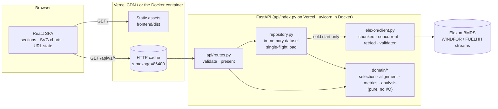

# Gale: architecture

This document is the outline for the five-minute tech-lead walkthrough. Each section maps to roughly one minute.

## 1. Shape of the system

The code has four layers, and dependencies only point inward:

| Layer | Responsibility | Knows about |
|---|---|---|
| `elexon/` | HTTP: parameter names, chunking, retries, payload validation, the "silently ignored filter" guard | httpx, pydantic, domain value types |
| `repository.py` | Fetches the January scope once, de-duplicates it, builds `Analytics`, and shares it between requests | client, domain |
| `domain/` | Every business rule: delivery day, forecast selection, hindcast exclusion, alignment, metrics, band, buffer, timing | stdlib only (`zoneinfo`, `bisect`, `statistics`) |
| `api/` | Query validation, response models, rounding, error envelope, cache headers | FastAPI, domain, repository |

The domain layer has no framework imports, so most tests are plain function calls on hand-built data.

## 2. Request flow

1. The browser asks for `/api/v1/decision?delivery_date=2026-01-15&decision_time=09:20`. Vercel's edge cache answers it if a previous request warmed it.
2. `routes.decision` validates `decision_time`, which must match `HH:MM` and be before 23:00, and checks that `delivery_date` is in scope. Failures return **422**.
3. `get_dataset` awaits `ElexonRepository.dataset()`.
   - **Warm:** it returns the cached `Dataset` immediately.
   - **Cold:** the first caller starts one `asyncio.Task` that runs `_load()`. Every concurrent caller awaits the same task through `asyncio.shield`, so a client disconnecting cannot cancel a load that others are waiting on. A failed load is not cached; the next request retries.
4. `_load()` opens an `httpx.AsyncClient`. The client splits the publish window (31 Dec 00:00 to 31 Jan 23:00 UTC) and the settlement dates (1 Jan to 1 Feb) into 7-day chunks. It fetches them concurrently, with at most 4 requests in flight, retries on 408/425/429/5xx and transport errors with exponential backoff, and honours `Retry-After`.
5. Every payload is validated by pydantic: timestamps must carry an offset, and required fields must be present. Every row is then checked against the window that was asked for, because Elexon silently ignores unknown parameters and returns today's data instead. Anything wrong raises `ElexonError`, which the API maps to **502** with a generic message.
6. Rows are de-duplicated and the `Analytics` object is built. Its `ForecastIndex` is a dict from target hour to publish times sorted ascending, so selecting a forecast is one `bisect`.
7. The CPU-bound analytics run in the thread pool (`run_in_threadpool`) so the event loop stays free. The presenter rounds MW to 0.1 and GWh to 0.001, the response carries `Cache-Control: public, max-age=300, s-maxage=86400`, and gzip compresses it.

Cold start against the real API takes about 2 s. Warm endpoints respond in 10–20 ms, except `/timing` on its first call (about 0.3 s; the result is then cached).

## 3. Key decisions and trade-offs

**No database, no Redis.** The scope is about 18.7k forecast rows and 1.5k actual rows (about 2.4 MB of JSON). It is historical, so it never changes. A process-local cache costs one fetch per cold instance. In exchange there is no infrastructure, no migrations and no staleness logic, and the CDN `s-maxage` means most traffic never reaches Python. If the scope grew to years of data, or needed live updates, the next step would be a scheduled job writing Parquet or Postgres, with the repository reading from it. The `WindRepository` protocol is the seam for that.

**No pandas or numpy.** The work is about 100k bisects and sorts of at most a few thousand floats. The stdlib does that in milliseconds. It keeps the Vercel bundle small and the cold start fast, and keeps every formula explicit. The quantile function is a dozen lines of Hyndman–Fan type 7, tested against `statistics.quantiles`.

**Delivery day = 23:00 to 23:00 UK.** Both auctions publish this as their contract day: EPEX's GB 60-min auction runs "Hour 23-00 … Hour 22-23", and Nord Pool's GB regulations say "starting from 23:00 UK time". Using the 00:00–24:00 settlement day would score hours the desk did not buy in that auction. `periods.py` owns the rule, and `zoneinfo` makes clock-change days 23 or 25 hours long without special cases. Tests cover both.

**Selection is schedule-agnostic.** For each hour, Gale takes `max(publishTime)` subject to `publishTime ≤ decision` and `publishTime ≤ hour start`. The second condition is the hindcast exclusion: each WINDFOR run restates hours since 21:00 the previous day, and those rows are not forecasts. Nothing assumes the eight-a-day schedule, so the irregular 12:25 run on 15 January is found by the same bisect. Tests pin the edge cases: a decision exactly at a publish time includes that run, and one second earlier does not. An hour that begins exactly at the publish time counts as a forecast.

**Alignment: the hourly mean of two settlement periods.** The day-ahead products being bought are hourly, and the mean of the two half-hour MW averages is the MWh delivered in that hour. A missing half makes the whole hour a gap rather than a guess. The alternatives move headline MAE by under 2%: matching on identical `startTime`, or a window centred on the hour.

**Two error populations, on purpose.**
- *Decision population.* For one decision time, these are the 744 hours scored with the forecast actually on the desk. MAE, bias, the buffer, the by-day and by-hour charts, and the gate comparison all use it.
- *Horizon population.* These are all January runs at every lead time, 14,295 samples. They drive the horizon chart and the uncertainty band. The band takes the P10–P90 of errors within ±3 h of each point's lead time, which pools about 1,700 samples per point. Hour-of-day buckets would give only 31 samples each.

**The buffer is an empirical quantile.**
- The buffer at confidence *c* is the *c*-quantile of `forecast − actual`. Planning that many MW below the forecast leaves wind short of the plan in a 1 − *c* share of January hours, by construction.
- The in-sample breach rate is therefore tautological, so the API also returns a **leave-one-day-out** count: each day's buffer is estimated from the other 30 days and then tested on the held-out day. At 90% this gives 11.4%, close to the 10% target. That is the honest evidence that the rule generalises.
- **Shortfall MWh beyond the buffer** puts a size on the tail that remains.

**The frontend stays minimal.** The dependencies are React, d3-scale and d3-shape, plus a self-hosted Inter font for platforms without SF Pro. There is no router, state library or component kit. Charts are hand-built SVG, which allows:
- a crosshair that snaps to the nearest hour on mouse, touch and arrow keys;
- tooltips that never gate data, because every chart has a "View data" table;
- solid versus dashed lines, so identity does not depend on hue alone (the palette is validated for colour-vision deficiency in both themes);
- tweened transitions that respect `prefers-reduced-motion`;
- the previous frame held at reduced opacity while new data loads;
- true pixel widths from the first paint: each chart measures its container synchronously when it mounts, then follows it with a `ResizeObserver`, and the container (`.plot`, `contain: inline-size`) takes its width from layout, never from the SVG inside it;
- one label-placement helper (`lib/labels.ts`) for every annotation: it keeps labels inside the plot, nudges or stacks the ones that collide, and drops the lower-priority one when there is no room.

The hero leads with the product: a ribbon of all 744 delivery hours, forecast at the chosen gate against outturn, with the gap shaded solid where the forecast ran high and hatched where it ran low. It comes from `GET /api/v1/series`, which reuses `Analytics.outcomes` for each delivery day, so it can never disagree with the decision view. Picking a day on it (pointer, tap, or arrow keys and Enter) opens that day in section 01. On a phone it plots six-hour means.

State lives in `App.tsx`, and the delivery day and gate are mirrored into the URL, so any view can be shared as a link.

**One container, or serverless.** The Docker image builds the SPA with Node, resolves Python dependencies with uv, then copies the venv and `dist/` into `python:3.12-slim`. It runs as a non-root user, has a `HEALTHCHECK`, and serves the frontend and `/api` on `$PORT`. On Vercel, the same FastAPI app is a Python function (`api/index.py`), the SPA is served from the CDN, and `/api/*` is rewritten to the function.

## 4. Quality gates

- **85 backend tests, with no network.**
  - Domain rules on small synthetic markets where every expected value is worked out by hand in the test's docstring.
  - Client behaviour through `httpx.MockTransport`: chunk parameters, retries and backoff, `Retry-After`, 4xx not retried, malformed payloads, non-JSON bodies, rows outside the requested window.
  - Repository single-flight: ten concurrent cold callers cause exactly one call to each dataset.
  - API contract tests with a fake repository: 200, 422, 404, 502 and 500 envelopes, cache headers, and the static mount. The month series is checked hour for hour against the decision view.
- **ruff, ruff format and mypy `--strict`** on src and tests; **ESLint strict-type-checked** with React Compiler rules, and `tsc --noEmit` with `noUncheckedIndexedAccess`.
- **Vitest** for formatting (UK time across GMT and BST), series helpers, label placement, bar geometry, tweening and URL state.
- **`scripts/crosscheck.py`** recomputes the headline numbers from raw Elexon responses using deliberately naive, stdlib-only code, and compares them with a running API. It covers the run selected at each gate, one hour's forecast, actual and error, the irregular run, MAE, bias, RMSE, the buffer and breaches, and the worst day's energy.
- **CI** (`.github/workflows/ci.yml`) runs all of the above and builds the Docker image.

## 5. How to extend

| Change | Where |
|---|---|
| Another month or season | `GALE_FIRST_DECISION_DATE` / `GALE_LAST_DECISION_DATE` (fetch windows derive from `Scope`) |
| Another gate (e.g. a half-hourly auction) | Add a `DecisionPreset` in `domain/markets.py`; the UI picks it up from `/api/v1/meta` |
| Out-of-sample band (trailing window instead of in-month) | `Analytics.error_quantiles_at_lead`: filter samples by publish time before the decision |
| Persisted data / scheduled refresh | Implement `WindRepository` against a store; routes and domain are unchanged |
| Solar or demand forecasts | New client method + schema; selection, alignment and metrics are dataset-agnostic |
| Bias-corrected forecast | A new presenter field `forecast - median(error at lead)`; the quantiles already exist |

## 6. Walkthrough outline (5 min)

1. **(0:00)** Problem and scope: one page shows January's decisions; the data is immutable, so it is cached at every layer.
2. **(0:45)** The diagram above: four layers, dependencies inward, and the domain is pure.
3. **(1:30)** Open `domain/selection.py`: one bisect gives "latest run at decision time, never a hindcast". Show the edge-case tests.
4. **(2:15)** Open `domain/periods.py` and `alignment.py`: the 23:00 contract day, `zoneinfo`, and why the hourly mean is the right unit.
5. **(3:00)** Open `analysis.buffer_table`: the empirical quantile and the leave-one-day-out honesty check.
6. **(3:40)** Open `elexon/client.py` and `repository.py`: chunked, concurrent fetching, the window guard, single-flight, and failures that are not cached.
7. **(4:20)** Deployment: the Docker multi-stage build against Vercel; cache headers turn cold starts into CDN hits. Close with the extension table.
